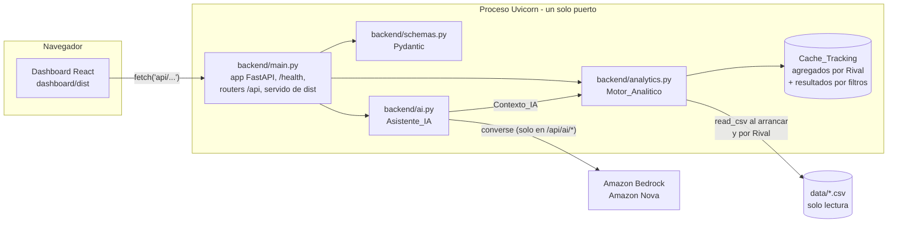
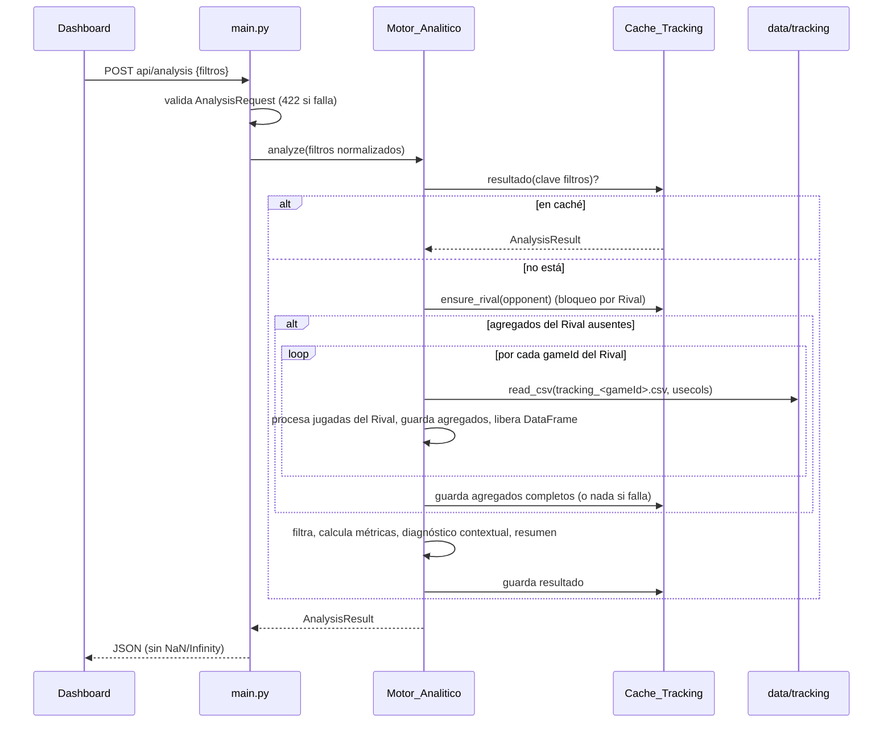
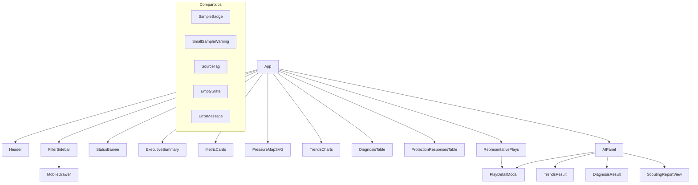

# Design Document: PocketIQ

## Overview

PocketIQ responde a la pregunta "¿Cómo nos va a atacar esta defensa?" con datos del NFL Big Data Bowl 2021 (semanas 1 a 8). El entrenador elige un Rival y una situación (down, banda de distancia, formación, personal, número de bloqueadores, zona del campo, tipo de dropback, play action, semana y, como análisis posterior, cobertura ejecutada). La aplicación devuelve la frecuencia de blitz aproximado, por dónde entra la amenaza, cuánto tarda en aparecer, qué posibles fuentes de presión se observan y qué respuestas de protección se asocian con mejores resultados en esa muestra.

El diseño se apoya en tres principios:

1. **Python calcula todo.** `backend/analytics.py` contiene funciones puras y deterministas sobre DataFrames en memoria. El Dashboard solo formatea. Amazon Nova solo redacta a partir de agregados ya calculados.
2. **Tracking bajo demanda por Rival.** Las cuatro tablas pequeñas (~15 MB) se cargan al arrancar. El tracking (~826 MB en 122 archivos) se procesa por Rival en la primera consulta, un archivo a la vez, y se guardan solo agregados por jugada y trayectorias recortadas.
3. **Cada dato lleva su fuente.** Toda métrica se etiqueta como "observada", "PFF" o "inferida", y cada bloque lleva su n y su Calidad_Muestra.

### Decisiones principales

| Tema | Decisión | Motivo |
|---|---|---|
| Carga de tracking | Perezosa por Rival, `pd.read_csv(usecols=..., dtype=...)` por partido, bloqueo por Rival | Cumple Req 2.4 a 2.9; un Rival juega ~8 partidos (~55 MB de CSV), primera consulta estimada en 3 a 10 s |
| Integración IA | boto3 Converse API (`bedrock-runtime.converse`) con prompt de sistema que exige solo JSON | Una sola llamada, sin bucle de agente ni herramientas; el doble de prueba es un objeto con un método `converse`; strands-agents agrega capas que no se necesitan para salida estructurada de un turno |
| Tiempo límite IA | `botocore.config.Config(connect_timeout=t, read_timeout=t, retries={"max_attempts": 1})` más `concurrent.futures` con `future.result(timeout=t)` | `read_timeout` es por lectura de socket, no total; el futuro garantiza respuesta a más tardar en t + ~1 s (Req 24.9 pide ≤ t + 5 s). botocore viene con boto3 y `concurrent.futures` es biblioteca estándar |
| Servido del build | Ruta comodín propia en lugar de `StaticFiles` | `StaticFiles(check_dir=True)` falla si `dashboard/dist` no existe (Req 1.6); la ruta propia nunca sombrea `/api/` |
| Pruebas de propiedad | `pytest.mark.parametrize` y `random.Random(semilla)` | No se permite `hypothesis` (Req 22.11) |
| Ubicación de pruebas | `tests/` en la raíz | Req 24.4 prohíbe que el código de `backend/` mencione los nombres de las variables de credenciales; las pruebas sí los necesitan para inyectar valores falsos |
| Umbral contextual (Req 12.8) | Percentil 75 de timeToThrow válidos de la muestra filtrada, con al menos 10 valores | Determinista, documentado; con menos de 10 valores el criterio no se evalúa |
| Stunt (Req 12.7) | N = 3 cuadros consecutivos (0.3 s) | Filtra cambios de un solo cuadro por ruido de posición |
| Orientación de Sectores | `y_norm` mayor que el del QB = izquierda del QB | Ver "Orientación de Sectores" |

### Supuestos heredados

Se respetan los supuestos 1 a 8 de `requirements.md`. Observación: ahora existe `verificacion_datos.md` en la raíz; el diseño no depende de él, pero sus hechos son compatibles con `diagnostico_inicial.md`.

## Architecture



### Flujo de una consulta de análisis



### Estructura de archivos

```
backend/
  __init__.py
  main.py          # cargar_env(), app, /health, routers, servido de dist
  schemas.py       # modelos Pydantic de entrada y salida
  analytics.py     # Motor_Analitico: carga, Validador_Datos, Tabla_Analitica, métricas, resumen, reporte determinista
  ai.py            # Asistente_IA: Contexto_IA, cliente Bedrock perezoso, validación de Respuesta_IA
  language.py      # detector de lenguaje prohibido compartido (opcional; puede vivir en analytics.py)
tests/
  conftest.py      # fábricas de DataFrames en memoria, motor de prueba, cliente falso de Bedrock
  test_api.py
  test_rules.py    # bandas, zonas, calidad, eventos, normalización, sectores, diagnósticos
  test_properties.py
  test_ai.py
  test_smoke_real_data.py   # opcional, marcado, usa data/ real
dashboard/
  vite.config.ts   # base './', proxy /api -> http://localhost:8000
  tailwind.config.js
  src/
    main.tsx, App.tsx, index.css
    api.ts, types.ts, format.ts
    components/...  (ver Components and Interfaces)
```

### Ciclo de vida del Backend

1. `backend/main.py` empieza con el bloque `cargar_env()` copiado literalmente de `.kiro/steering/rules.md` y lo ejecuta.
2. Después importa `backend.schemas`, `backend.analytics` y `backend.ai`. Importar `ai.py` no crea clientes ni llama a Bedrock (Req 24.15).
3. Un `lifespan` de FastAPI llama a `analytics.load_engine(DATA_DIR)`, que lee las cuatro tablas, valida columnas (si falta archivo o columna lanza `DataLoadError` y Uvicorn detiene el arranque, Req 2.13) y construye la Tabla_Analitica con los agregados PFF.
4. El motor queda en una variable de módulo accesible con la dependencia `get_engine()`. Las pruebas la sustituyen con `app.dependency_overrides[get_engine]` o con `set_engine(engine)`.

FastAPI ejecuta los endpoints `def` (síncronos) en su threadpool, así que una consulta que procesa tracking no bloquea `/health` ni otras consultas. Por eso Cache_Tracking usa `threading.Lock`.

### Rendimiento y memoria

| Elemento | Estimación |
|---|---|
| Tablas pequeñas en pandas | ~60 MB en memoria (PFF 188k filas × 15 columnas es lo mayor) |
| Un archivo de tracking crudo con 9 columnas y `dtype` reducidos | ~68k filas, ~5 MB en memoria; lectura ~0.2 a 0.5 s |
| Primera consulta de un Rival (~8 partidos, ~270 jugadas propias) | 3 a 10 s en una laptop; muy por debajo de los 60 s del Req 23.5 |
| Trayectorias recortadas por jugada (≈30 cuadros × 23 objetos, `int16` + 2 × `float32`) | ~7 KB; ~2 MB por Rival; ~60 MB si se consultan los 32 Rivales |
| Resultados por combinación de filtros | Dict LRU de 256 entradas, ~50 KB cada una |

Solo se procesan las filas de jugadas donde el Rival defiende; las jugadas donde ataca se descartan al leer cada archivo.

## Components and Interfaces

### 1. `backend/main.py`

```python
# (inicio literal del bloque cargar_env() de rules.md)
import os
from pathlib import Path

def cargar_env(): ...   # código exacto de rules.md
cargar_env()

from fastapi import FastAPI, Depends, HTTPException
from backend import schemas, analytics, ai

ROOT = Path(__file__).resolve().parent.parent
DATA_DIR = ROOT / "data"
DIST_DIR = ROOT / "dashboard" / "dist"

app = FastAPI(title="PocketIQ", lifespan=lifespan)

@app.get("/health")                      -> {"status": "ok"}
@app.get("/api/filters")                 -> schemas.FiltersResponse
@app.post("/api/analysis")               -> schemas.AnalysisResponse
@app.get("/api/plays/{game_id}/{play_id}") -> schemas.PlayDetailResponse   # game_id:int, play_id:int (422 automático)
@app.get("/api/status/{opponent}")       -> schemas.StatusResponse          # opcional: trackingReady, inProgress
@app.post("/api/ai/trends")              -> schemas.TrendsResponse | schemas.AIUnavailable
@app.post("/api/ai/diagnosis")           -> schemas.DiagnosisResponse | schemas.AIUnavailable
@app.post("/api/ai/scouting-report")     -> schemas.ScoutingReportResponse
@app.api_route("/api/{rest:path}", methods=[GET, POST, PUT, PATCH, DELETE])  -> 404 JSON {"detail": "Ruta de API no encontrada"}
@app.get("/{full_path:path}")            -> archivo de dist, index.html o 404 JSON
```

Reglas del servido estático (`serve_dist(full_path)`):

1. Si `full_path` empieza con `api/` nunca llega aquí (la ruta anterior lo captura y responde 404 JSON).
2. Se resuelve `DIST_DIR / full_path`; si el resultado no queda dentro de `DIST_DIR` (recorrido con `..`), 404.
3. Si es un archivo existente, `FileResponse`.
4. Si no, y existe `DIST_DIR / "index.html"`, se devuelve `index.html` (fallback de SPA y `GET /`).
5. Si `dist` no existe, 404 JSON `{"detail": "Dashboard no compilado"}`. El arranque no se ve afectado (Req 1.6).

Manejadores de error:

- `RequestValidationError` → 422 con `{"detail": [{"field": "exactDistance", "message": "debe ser un entero entre 1 y 99"}]}` (Req 6.6, 13.10, 14.5). El mensaje se arma con `loc` y `msg` de Pydantic, sin valores de entorno.
- `analytics.AnalysisError` / `analytics.TrackingComputationError` → 500 `{"detail": "El análisis no se pudo completar"}` o `{"detail": "El análisis de tracking del Rival no se pudo completar"}`, sin rutas ni trazas (Req 2.15, 14.9). La traza completa va al registro técnico con `logger.exception`, que no incluye variables de entorno.
- Toda respuesta pasa por `json_safe()` (ver Data Models) y se devuelve con `JSONResponse`.

### 2. `backend/analytics.py` (Motor_Analitico)

Interfaz pública:

```python
class DataLoadError(Exception): ...          # archivo/columna faltante al arrancar
class AnalysisError(Exception): ...
class TrackingComputationError(AnalysisError): ...

TrackingLoader = Callable[[int], pd.DataFrame]   # gameId -> DataFrame con TRACKING_COLUMNS; lanza FileNotFoundError/OSError

def load_engine(data_dir: Path) -> "Engine"
class Engine:
    @classmethod
    def from_frames(cls, games, plays, players, pff, tracking_loader: TrackingLoader) -> "Engine"
    def filters(self) -> dict
    def analyze(self, f: NormalizedFilters) -> AnalysisResult           # usa caché de resultados
    def play_detail(self, game_id: int, play_id: int) -> PlayDetail | None
    def rival_status(self, opponent: str) -> dict
    def scouting_report_deterministic(self, result: AnalysisResult) -> ScoutingReport

# funciones puras (probadas en aislamiento)
def distance_band(down, yards_to_go) -> str | None
def distance_to_endzone(yardline_number, yardline_side, possession_team) -> int | None
def field_zone(down, dist_to_endzone) -> str | None
def sample_quality(n: int) -> str
def safe_rate(num: int, den: int) -> float | None
def normalize_xy(x, y, play_direction) -> tuple[float | None, float | None]
def select_event_frame(ball_events: pd.DataFrame, manual: str, auto: str) -> tuple[int | None, str]
def time_to_throw(snap_frame, pass_frame) -> tuple[float | None, str | None]
def sector_for(lateral_delta: float) -> str
def compute_static_diagnoses(play_pff, tracking_aggs) -> list[tuple[str, str]]
def contextual_threshold(ttt_values: Sequence[float]) -> float | None
def summary_text(result_fields, opponent) -> str
def forbidden_language(text: str, extra_terms: bool = False) -> bool
```

Constantes documentadas:

```python
TRACKING_COLUMNS = ["gameId","playId","nflId","frameId","team","playDirection","x","y","event"]
TRACKING_DTYPES  = {"gameId":"int64","playId":"int32","nflId":"float64","frameId":"int16",
                    "team":"category","playDirection":"category","x":"float32","y":"float32","event":"string"}
THREAT_DISTANCE_YD = 2.0
STUNT_MIN_FRAMES = 3                  # 0.3 s
STUNT_BLOCKER_MAX_DIST_YD = 3.0       # el bloqueador "más cercano" debe estar a ≤ 3 yd para contar
CONTEXT_PERCENTILE = 75               # umbral de timeToThrow para Req 12.8
CONTEXT_MIN_VALID = 10
QB_POCKET_LATERAL_MARGIN_YD = 1.0
QB_POCKET_DEFAULT_HALF_WIDTH_YD = 4.0
QB_POCKET_DEPTH_YD = 3.0
QB_CLOSING_MIN_YD = 1.0
LATERAL_SIGN = +1                     # única corrección global permitida (Req 11.6)
RESULT_CACHE_MAX = 256
SECTORS = ["Izquierda","Interior izquierda","Centro","Interior derecha","Derecha"]
DIAGNOSES = ["Derrota individual","Posible rusher libre","Doble equipo","Chip o ayuda",
             "Posible intercambio o stunt",
             "Posible presión prolongada por movimiento o retención del QB",
             "No determinado con los datos disponibles"]
DISTANCE_BANDS = ["Corta","Media","Larga","Muy larga","Conversión"]
FIELD_ZONES = ["Propio 1–20","Propio 21–40","Medio campo","Territorio rival","Zona roja","Conversión de dos puntos"]
```

#### 2.1 Carga y Validador_Datos

`load_engine` lee con `pd.read_csv(path, keep_default_na=True)` solo los cuatro archivos y comprueba columnas requeridas:

| Archivo | Columnas requeridas |
|---|---|
| games.csv | gameId, week |
| plays.csv | gameId, playId, playDescription, quarter, gameClock, down, yardsToGo, possessionTeam, defensiveTeam, yardlineSide, yardlineNumber, offenseFormation, personnelO, personnelD, defendersInBox, pff_playAction, dropBackType, pff_passCoverage, pff_passCoverageType, passResult, prePenaltyPlayResult, playResult |
| players.csv | nflId, displayName, officialPosition |
| pffScoutingData.csv | gameId, playId, nflId, pff_role, pff_positionLinedUp, pff_hit, pff_hurry, pff_sack, pff_beatenByDefender, pff_hitAllowed, pff_hurryAllowed, pff_sackAllowed, pff_nflIdBlockedPlayer, pff_blockType |

El Validador_Datos es un conjunto de funciones que devuelven `(datos_filtrados, casos_afectados)` y un acumulador `ValidationLog` que emite **una** advertencia por (comprobación, archivo) solo si `casos > 0` (Req 3.7, 3.8, 3.11):

```python
logger.warning("validacion=%s archivo=%s casos=%d", nombre, archivo.name, casos)
```

Comprobaciones: `plays_llave_duplicada` (conserva la primera), `pff_nflId_sin_jugador`, `pff_roles_no_11_11` (deja nulos passRushers/passBlockers), `tracking_team_invalido`, `tracking_balon_no_unico_por_cuadro`, `tiempo_invalido`, `fieldZone_sin_datos`, `yardsToGo_inconsistente`, `playDirection_invalido`.

Los archivos se abren solo con `read_csv` (lectura). El motor no tiene ninguna llamada de escritura a disco.

#### 2.2 Construcción de la Tabla_Analitica (al arrancar)

Agregados PFF vectorizados con `groupby(["gameId","playId"])`:

```text
pff_roles = pff con pff_role
rushers  = pff[pff_role == "Pass Rush"]
blockers = pff[pff_role == "Pass Block"]
chips    = pff[(pff_role == "Pass Route") & (pff_blockType.notna() | pff_nflIdBlockedPlayer.notna())]

passRushers  = count(rushers) por jugada; nulo si la jugada falla 11/11
passBlockers = count(blockers) por jugada; nulo si la jugada falla 11/11
hasX (X ∈ hurry, hit, sack, beatenBlocker[pff_beatenByDefender]):
    si todos los valores del campo son nulos en la jugada -> nulo
    si no -> any(campo == 1)
hasPffPressure = nulo si pff_hit, pff_hurry y pff_sack son nulos en todos los jugadores;
                 si no, any(hit==1 | hurry==1 | sack==1)
hasOffensiveCharge = sobre blockers: nulo si los tres campos *Allowed son nulos en todos; si no any(==1)
blockTypes = frozenset(blockers.pff_blockType.dropna())
blockedIds = set(pff_nflIdBlockedPlayer no nulo de blockers ∪ chips)
dblTeam   = existe valor no nulo de pff_nflIdBlockedPlayer repetido ≥ 2 veces entre blockers
chipFlag  = any(pff_blockType == "CH") en cualquier jugador  ∨  len(chips) ≥ 1
beaten    = any(fillna(0) de beatenByDefender|hitAllowed|hurryAllowed|sackAllowed == 1) en blockers
```

Las jugadas sin filas PFF conservan su fila con todas esas columnas nulas (Req 4.16). Columnas de contexto: `distanceBand`, `fieldZone`, `playAction = pff_playAction == 1`, `coverage = pff_passCoverage`, `coverageType = pff_passCoverageType`, `week` por unión con games.

Las columnas de tracking (`snapFrame`, `timeToThrow`, `threatTime`, etc.) empiezan como nulas con `trackingStatus = "pendiente"` y se rellenan al procesar al Rival.

#### 2.3 Procesamiento de tracking por Rival

```text
ensure_rival(opponent):
    with global_lock: lock = rival_locks.setdefault(opponent, Lock())
    with lock:
        if opponent in rival_aggs: return rival_aggs[opponent]
        try:
            acc = RivalAccumulator()
            for gameId in sorted(games donde defensiveTeam == opponent):
                try: raw = tracking_loader(gameId)            # usecols + dtype
                except (FileNotFoundError, OSError, ParserError):
                    acc.skipped_games.append(gameId); marcar jugadas "sin tracking"; continue
                raw = raw[raw.playId ∈ jugadas del Rival en ese gameId]
                aggs, trajs = process_game(raw, plays_ctx, pff_ctx)   # vectorizado
                acc.add(aggs, trajs)
                del raw                                       # un solo DataFrame crudo a la vez
            rival_aggs[opponent] = acc.freeze()               # inserción atómica al final
        except Exception as e:
            # nada parcial queda en rival_aggs; el with libera el lock
            raise TrackingComputationError from e
    return rival_aggs[opponent]
```

`process_game` aplica, en orden: validación de `team` (Req 3.4), balón único por cuadro (Req 3.5), `playDirection` válido (Req 8.5), normalización, selección de eventos con las filas del balón, Ventana_Evaluacion, distancias Rusher–QB, amenaza, Sector, flags de diagnósticos de tracking, flag de movimiento del QB y recorte de trayectorias. Las distancias se calculan con un `merge` de filas de Rushers y del QB sobre `(playId, frameId)` y operaciones numpy; luego `groupby(playId)`.

La Tabla_Analitica completa (con tracking) para un Rival es `base_table[defensiveTeam == opponent]` unida con los agregados del Rival por `(gameId, playId)`.

#### 2.4 Filtrado y métricas (por consulta)

```text
analyze(f):
    key = canonical_key(f)                       # json.dumps(f normalizado, sort_keys=True)
    if key in result_cache: move_to_end(key); return result_cache[key]
    t = rival_table(f.opponent)                  # llama ensure_rival
    m = máscara True
    for cada filtro no nulo: m &= (columna == valor)
        exactDistance activo: m &= (yardsToGo == v) & (down != 0) ; ignora distanceBand
        distanceBand activo: m &= (distanceBand == v)          # yardsToGo inconsistente -> distanceBand nulo -> excluido
        fieldZone activo: m &= (fieldZone == v)                # nulo excluido (Req 5.7)
    s = t[m]
    threshold = contextual_threshold(s.timeToThrow.dropna())
    s.diagnoses = static_diagnoses + (label12_8 si aplica con threshold) ; "No determinado" si vacío
    result = build_result(s, f, threshold)       # summary, pressureMap, diagnoses, distribuciones, protecciones, representativas, texto
    result_cache[key] = result; si len > RESULT_CACHE_MAX: popitem(last=False)
    return result
```

El resultado guardado es inmutable (se serializa a dict una vez y se guarda el dict), así que una segunda consulta devuelve un resultado idéntico campo por campo (Req 2.8, 14.6). Si `build_result` lanza, no se guarda nada (Req 14.9).

Definiciones de métricas de `summary` (denominador = jugadas de la muestra con el campo no nulo; `safe_rate` devuelve `None` si el denominador es 0):

| Campo | Numerador / denominador | Fuente |
|---|---|---|
| blitzRate | passRushers ≥ 5 / passRushers no nulo | inferida |
| averageRushers | media de passRushers no nulos | PFF |
| pffPressureRate | hasPffPressure verdadero / no nulo | PFF |
| hurryRate, hitRate | hasHurry / hasHit verdadero / no nulo | PFF |
| sackRate | passResult == "S" / passResult no nulo | observada |
| pffSackRate | hasSack verdadero / no nulo | PFF |
| sackDiscrepancy | jugadas con (S y hasSack falso) o (no S y hasSack verdadero); objeto presente solo si ≥ 1 | observada + PFF |
| averageThreatTime | media de threatTime no nulo | inferida |
| averageTimeToThrow | media de timeToThrow no nulo | observada |

`threatTimeSample` y `timeToThrowSample` llevan su propio n y Calidad_Muestra (Req 10.2). Las jugadas evaluables para amenaza son las que tienen `threatReason` nulo o `"sin amenaza"`; las excluidas por Req 9.6 no entran ni en numerador ni en denominador.

`pressureMap`: para cada Sector, `plays` = jugadas con `threatSide == sector`; `share = plays / jugadas con threatSide no nulo` (0 si el total es 0); `hurries`, `hits`, `sacks` = jugadas del Sector con `hasHurry`, `hasHit`, `hasSack` verdaderos; `averageThreatTime` de esas jugadas o `None`.

`diagnoses` (n ≥ 1): siete filas en el orden de `DIAGNOSES` con `label`, `source`, `plays`, `share = plays / n`, `hurries`, `hits`, `sacks`, `averageThreatTime`, `threatTimeN`.

`rusherDistribution`: por valor de passRushers presente, `{rushers, plays, share}`, más `blitzPlays` y `blitzShare`.

`coverageDistribution`: por `coverage`, `{value, plays, share}` ordenado por plays desc y valor asc. `personnelDistribution` igual con `personnelD`. `downDistanceDistribution`: por (down, distanceBand) presente, `{down, distanceBand, plays, pffPressureRate}`.

`protectionResponses`: lista de seis dimensiones en este orden: `offenseFormation`, `passBlockers`, `playAction`, `dropBackType`, `blockType`, `personnelO`. Cada dimensión tiene `dimension`, `label`, `multiMembership` (verdadero solo en `blockType`) y `alternatives`. Por alternativa: `value`, `plays`, `pffPressureRate`, `sackRate` (passResult S / n), `averageThreatTime`, `completionRate` (passResult C / n), `avgPrePenaltyYards`, `avgPlayResult`, `quality`, `source`. Las jugadas con valor nulo en la dimensión se excluyen solo de esa dimensión. En `blockType`, una jugada cuenta en cada X ∈ `blockTypes`. Orden de entrega: `value` ascendente como texto (el Dashboard reordena, Req 19.7).

### 3. `backend/schemas.py`

Modelos completos en la sección Data Models. Todos con `model_config = ConfigDict(extra="forbid")` en las entradas para rechazar campos desconocidos con 422.

### 4. `backend/ai.py` (Asistente_IA)

```python
DEFAULT_MODEL_ID = "us.amazon.nova-pro-v1:0"    # único literal de modelo en el código

def model_id() -> str:  return os.environ.get("BEDROCK_MODEL_ID", DEFAULT_MODEL_ID)
def region() -> str:    return os.environ.get("AWS_REGION", "us-east-1")
def timeout_seconds() -> float:   # AI_TIMEOUT_SECONDS en [1, 120]; si no, 30
def default_client_factory():
    cfg = Config(connect_timeout=t, read_timeout=t, retries={"max_attempts": 1})
    return boto3.client("bedrock-runtime", region_name=region(), config=cfg)

_client_factory: Callable[[], Any] = default_client_factory   # sustituible en pruebas
def set_client_factory(factory) -> None

def build_context(result: AnalysisResult, play: dict | None = None) -> dict          # Contexto_IA
def invoke_nova(system_prompt: str, context: dict) -> dict                          # lanza AIUnavailableError
def trends(engine, filters) -> dict
def diagnosis(engine, filters, game_id: int | None, play_id: int | None) -> dict
def scouting_report(engine, filters) -> dict
def validate_facts(facts, ctx) -> tuple[list, int]
def validate_hechos_hipotesis(raw, ctx) -> tuple[list, list]
def validate_recommendations(items, result) -> tuple[list, int]
```

`config=` es un argumento de configuración de red, no de credenciales; el cliente no recibe llaves, token ni perfil (Req 24.3). Ningún archivo de `backend/` contiene los nombres de las variables de credenciales; boto3 las resuelve con su cadena predeterminada.

`invoke_nova`:

```text
client = _client_factory()                       # perezoso: solo al atender /api/ai/*
fut = EXECUTOR.submit(client.converse,
        modelId=model_id(),
        system=[{"text": system_prompt}],
        messages=[{"role": "user", "content": [{"text": json.dumps(context, ensure_ascii=False)}]}],
        inferenceConfig={"maxTokens": 2000, "temperature": 0})
try: resp = fut.result(timeout=timeout_seconds())
except TimeoutError | Exception: raise AIUnavailableError        # sin detalles al cliente
text = resp["output"]["message"]["content"][0]["text"]
quitar cercos ``` y espacios; json.loads(text)  -> si falla, AIUnavailableError
```

`EXECUTOR` es un `ThreadPoolExecutor(max_workers=4)` de módulo, creado de forma perezosa. Cualquier excepción se registra con `logger.warning("ia_no_disponible tipo=%s", type(e).__name__)`: solo el nombre del tipo, nunca el mensaje (los mensajes de botocore pueden incluir identificadores de cuenta).

Respuesta genérica de no disponibilidad (Req 24.9):

```json
{"available": false, "status": "IA no disponible", "reason": "El servicio de IA no respondió o devolvió una salida no válida."}
```

Prompts de sistema (resumidos; texto completo en `ai.py`): rol de analista en español; usar solo números presentes en `fields`; citar cada número como Hecho con `field` exacto; expresiones de asociación del Req 16.3; lista de términos prohibidos del Req 16.4 (y "responsable", "culpable", "falló" en diagnóstico); con n < 30 describir solo lo observado; responder **solo** con un objeto JSON del esquema indicado.

### 5. Detector de lenguaje prohibido (compartido)

```python
FORBIDDEN_PHRASES = ["esta formación evita la presión", "el tackle causó el sack", "esta es la mejor jugada"]
FORBIDDEN_WORDS   = ["causa", "causó", "evita", "garantiza", "la mejor", "la peor"]
BLAME_WORDS       = ["responsable", "culpable", "falló"]
def forbidden_language(text, include_blame=False) -> bool:
    t = unicodedata.normalize("NFC", text).casefold()
    patrones = frases + palabras (+ culpa) como r"(?<!\w)" + re.escape(p) + r"(?!\w)"
    return any(re.search(p, t) for p in patrones)
```

Lo usan el Generador_Resumen (prueba de que nunca dispara), el reporte determinista y las validaciones de `/api/ai/*`.

### 6. Dashboard (`dashboard/src`)



| Componente | Responsabilidad | Requisitos |
|---|---|---|
| `api.ts` | `getFilters()`, `postAnalysis(f)`, `getPlay(g,p)`, `getStatus(op)`, `postAI(kind, f)`; todas con `fetch('api/...')` sin diagonal inicial; distingue error 422 (filtro inválido) de otros | 1.7, 13.11, 14.10, 28.2 |
| `format.ts` | `pct(v)` → "37.5%", `secs(v)` → "2.4 s", `dec1`, `int`; `null` → "sin datos" | 17.5, 17.6 |
| `Header` | Título, subtítulo y descripción exactos | 17.1 |
| `FilterSidebar` / `MobileDrawer` | Columna lateral fija en `md:` (≥ 768 px); panel desplegable cerrado al cargar en < 768 px; "Todos" primero; Banda_Distancia "recomendada" y distancia exacta como opción secundaria con aviso; validación 1 a 99; sección "Análisis posterior al snap" con cobertura y nota; botón "Analizar defensa" | 6.7, 13.2 a 13.8 |
| `StatusBanner` | Mensaje "Procesando tracking del rival…" mientras la petición está pendiente (opcionalmente consulta `api/status/<rival>`) | 14.7 |
| `ExecutiveSummary` | `summary.text` sin cambios, n, partidos, Calidad_Muestra, advertencia, botón "Ampliar: quitar filtro de semana/cobertura/distancia exacta", estado vacío con filtros activos | 10.4 a 10.10, 17.2, 17.11 |
| `MetricCards` | Ocho tarjetas con rótulo, valor y `SourceTag`; texto secundario de sack PFF y discrepancias | 17.3 a 17.6, 4.13 |
| `PressureMapSVG` | SVG con cinco sectores (trapecios sobre un campo verde), texto con share, threatTime, hurries, hits, sacks y n; intensidad naranja según share; leyenda literal y nota de clasificación geométrica | 11.7, 17.7 a 17.10 |
| `TrendsCharts` | Recharts `BarChart`: rushers, coberturas ("cobertura ejecutada (PFF)"), personal defensivo, down × banda con tasa de evento PFF; etiquetas de valor en cada barra (`LabelList`) | 18.1, 18.4 a 18.7 |
| `DiagnosisTable` | Siete filas, nota "pueden sumar más de 100 %", nota de doble equipo, aviso "no son asignaciones confirmadas" | 12.5, 12.11, 12.12, 18.2, 18.3, 18.8 |
| `ProtectionResponsesTable` | Seis dimensiones; orden inicial por pffPressureRate asc y n desc; clic en encabezado asc/desc con `null` al final; nota de pertenencia múltiple en tipo de bloqueo; advertencia en n < 30 sin "recomendación" | 19.3, 19.7 a 19.9 |
| `RepresentativePlays` | Cinco categorías, "sin ejemplos en la muestra" si falta; campos del Req 20.5; nivel de confianza | 20.5, 20.6, 20.9, 20.10 |
| `PlayDetailModal` | SVG del campo en coordenadas normalizadas; Rushers como triángulos naranjas, Bloqueadores como cuadrados azules, Ayuda_Chip como cuadrados azules con contorno discontinuo, QB como círculo blanco con "QB", balón como rombo; deslizador `input[type=range]` por `frameId`; eventos y Cuadro_Snap/Cuadro_Pase marcados; Diagnosticos con fuente | 15, 20.8 |
| `AIPanel` | Tres acciones con estado independiente (`idle/loading/done/error`); "Generando…"; etiqueta "Generado por IA (Amazon Nova) – requiere validación"; "IA no disponible" en fallo | 28.1 a 28.9 |
| `DiagnosisResult` | Bloques "Hechos" e "Hipótesis" con encabezado, fuente y "requiere validación en video"; textos de vacío | 28.7 |
| `ScoutingReportView` | Seis secciones; "Reporte determinista sin IA"; "Copiar" (`navigator.clipboard?.writeText` con `try/catch` y aviso si falla o no existe) e "Imprimir" (`window.print()`, estilos `print:`) | 28.10 a 28.12 |
| `SampleBadge` / `SmallSampleWarning` | n y calidad como texto; advertencia con borde y texto "Muestra pequeña" o "Muestra insuficiente" | 10.4, 10.5 |
| `SourceTag` | Pastilla de texto "observada", "PFF" o "inferida", con icono de texto (●, ◆, ◇) | 21.4 |
| `WarningMarker` | Borde y textos "Advertencia: lenguaje a revisar" / "No verificado en los datos" | 28.13 |

Estado: solo hooks de React (`useState`, `useEffect`, `useMemo`, `useReducer` para filtros). `App` guarda `filters`, `filterOptions`, `analysis`, `analysisStatus` (`idle | loading | ok | error`), `errorKind` y `selectedPlay`. `AIPanel` guarda un estado por acción. Los filtros nunca se reinician ante un error.

Tema Tailwind 3 (`tailwind.config.js`, `theme.extend`, sin sintaxis de v4):

| Uso | Clases |
|---|---|
| Fondo de página / paneles | `bg-slate-950` / `bg-slate-900`, texto `text-slate-100` |
| Secundario (encabezados, bordes de panel, campo) | `emerald-400` / `emerald-700` / `bg-emerald-900` |
| Amenaza (Rusher, threatTime, Evento PFF, intensidad de Sector) | `orange-400`, `red-500` |
| Protección (Bloqueador, Ayuda_Chip, respuestas) | `sky-400`, `blue-500` |
| Advertencias de muestra | `border-2 border-dashed border-amber-400` + texto |

`text-slate-100` sobre `slate-950` supera 15:1; `orange-400` y `sky-400` sobre `slate-900` superan 6:1. En móvil el texto base es `text-sm` (14 px) o mayor. A ≥ 1024 px (`lg:`) la rejilla es de dos columnas (`lg:grid-cols-2`) y en 1920 × 1080 los filtros y el Mapa_Presion quedan en la primera pantalla. Ninguna fuente, imagen o script externo: se usa la pila de fuentes del sistema.

`vite.config.ts`:

```ts
export default defineConfig({
  base: './',
  plugins: [react()],
  server: { proxy: { '/api': 'http://localhost:8000' } },
})
```

El proxy usa `/api` porque es configuración del servidor de desarrollo, no una ruta escrita en `dashboard/src` (Req 1.9).

## Data Models

### Tabla_Analitica (DataFrame, una fila por jugada)

| Columna | Tipo | Origen |
|---|---|---|
| gameId, playId | int | plays |
| week | int | games |
| possessionTeam, defensiveTeam | str | plays |
| quarter, gameClock, down, yardsToGo | int / str | plays |
| distanceBand, fieldZone | str \| null | derivadas (Req 5, 6) |
| offenseFormation, personnelO, personnelD, defendersInBox, dropBackType | str/float \| null | plays |
| playAction | bool \| null | `pff_playAction == 1` |
| coverage, coverageType | str \| null | `pff_passCoverage`, `pff_passCoverageType` |
| passResult, prePenaltyPlayResult, playResult, playDescription | | plays |
| passRushers, passBlockers | Int \| null | PFF |
| hasPffPressure, hasHurry, hasHit, hasSack, hasBeatenBlocker, hasOffensiveCharge | bool \| null | PFF |
| blockTypes | frozenset[str] | PFF |
| snapFrame, passFrame, endFrame | Int \| null | tracking |
| snapSource, passSource | "manual" \| "automática" \| "ausente" | tracking |
| timeToThrow, timeToThrowReason | float \| null, str \| null | tracking |
| threatFrame, threatTime, threatReason | Int, float, str \| null | tracking |
| minRusherDistance, minDistanceTime | float \| null | tracking (2 y 1 decimales) |
| threatRusherId, lateralDelta, threatSide | | tracking |
| staticDiagnoses | tuple[str, ...] | criterios 12.2 a 12.7 |
| qbMovementFlag | bool \| null | geometría del Req 12.8 |
| pressureSourceCandidate | tuple[str, ...] | por consulta (agrega 12.8 y 12.9) |
| sampleQuality | str | Calidad_Muestra de la muestra filtrada (por consulta) |
| trackingStatus | "pendiente" \| "ok" \| "sin tracking" \| "dirección inválida" | |

Valores de `threatReason`: `"sin snap"`, `"sin QB"`, `"sin rusher"`, `"sin tracking"` (excluyen la jugada de numerador y denominador) o `"sin amenaza"` (evaluable sin amenaza). Valores de `timeToThrowReason`: `"sin snap"`, `"sin pase"`, `"pase no posterior al snap"`, `"sin tracking"`.

### Trayectorias recortadas (por jugada)

```python
@dataclass(frozen=True)
class Trajectory:
    nflIds: np.ndarray        # int64, -1 para el balón
    frameIds: np.ndarray      # int16, desde snapFrame hasta endFrame inclusive
    x_norm: np.ndarray        # float32 [objetos, cuadros], NaN si falta
    y_norm: np.ndarray        # float32
```

Se conservan también los eventos de la jugada como lista `[(frameId, event)]` del balón (Req 15.6). Las coordenadas originales `x`, `y` se usan para normalizar y depurar dentro de `process_game` (Req 8.3) y se descartan al liberar el DataFrame crudo, junto con él.

### Filtros normalizados

```python
@dataclass(frozen=True)
class NormalizedFilters:
    opponent: str
    down: int | None; distanceBand: str | None; exactDistance: int | None
    offenseFormation: str | None; defensivePersonnel: str | None; playAction: bool | None
    passBlockers: int | None; fieldZone: str | None; dropBackType: str | None
    coverage: str | None; week: int | None
```

`canonical_key` = `json.dumps(asdict(f), sort_keys=True)`. Los ausentes y nulos son el mismo `None`; `filtersApplied` los muestra como `"Todos"`.

### Esquemas Pydantic (`backend/schemas.py`)

```python
Quality = Literal["amplia", "moderada", "pequeña", "insuficiente"]
Source  = Literal["observada", "PFF", "inferida"]

class AnalysisRequest(BaseModel):
    model_config = ConfigDict(extra="forbid")
    opponent: str = Field(min_length=1, max_length=10)
    down: int | None = Field(None, ge=0, le=4)
    distanceBand: str | None = None
    exactDistance: int | None = Field(None, ge=1, le=99)
    offenseFormation: str | None = None
    defensivePersonnel: str | None = None
    playAction: bool | None = None
    passBlockers: int | None = Field(None, ge=0, le=11)
    fieldZone: str | None = None
    dropBackType: str | None = None
    coverage: str | None = None
    week: int | None = Field(None, ge=1, le=8)
    # enteros en modo estricto: StrictInt evita que 2.5 o "3" pasen como enteros

class SampleInfo(BaseModel):  n: int; quality: Quality
class Sample(BaseModel):      plays: int; games: int; quality: Quality; warning: str | None
class SackDiscrepancy(BaseModel): resultRate: float | None; pffRate: float | None; discrepantPlays: int

class Summary(BaseModel):
    text: str
    blitzRate: float | None; averageRushers: float | None; pffPressureRate: float | None
    hurryRate: float | None; hitRate: float | None; sackRate: float | None
    pffSackRate: float | None; sackDiscrepancy: SackDiscrepancy | None
    averageThreatTime: float | None; averageTimeToThrow: float | None
    threatTimeSample: SampleInfo; timeToThrowSample: SampleInfo; pressureSample: SampleInfo
    sources: dict[str, Source]          # fuente de cada métrica

class SectorStat(BaseModel):
    sector: str; plays: int; share: float; averageThreatTime: float | None
    hurries: int; hits: int; sacks: int; quality: Quality

class DiagnosisStat(BaseModel):
    label: str; source: Source; plays: int; share: float | None
    hurries: int; hits: int; sacks: int; averageThreatTime: float | None; threatTimeN: int

class RusherBucket(BaseModel):   rushers: int; plays: int; share: float
class RusherDistribution(BaseModel): buckets: list[RusherBucket]; blitzPlays: int; blitzShare: float | None; sample: SampleInfo
class CategoryBucket(BaseModel): value: str; plays: int; share: float
class DownDistanceBucket(BaseModel): down: int; distanceBand: str; plays: int; pffPressureRate: float | None

class ProtectionAlternative(BaseModel):
    value: str; plays: int; pffPressureRate: float | None; sackRate: float | None
    averageThreatTime: float | None; completionRate: float | None
    avgPrePenaltyYards: float | None; avgPlayResult: float | None; quality: Quality

class ProtectionDimension(BaseModel):
    dimension: Literal["offenseFormation","passBlockers","playAction","dropBackType","blockType","personnelO"]
    label: str; multiMembership: bool; alternatives: list[ProtectionAlternative]

class DiagnosisTag(BaseModel): label: str; source: Source

class RepresentativePlay(BaseModel):
    category: Literal["típica","amenaza temprana","sack","protección exitosa comparable",
                      "Posible intercambio o stunt o Posible rusher libre"]
    gameId: int; playId: int; week: int; down: int; yardsToGo: int
    offenseFormation: str | None; personnelD: str | None
    passRushers: int | None; passBlockers: int | None; coverage: str | None
    timeToThrow: float | None; threatTime: float | None
    passResult: str | None; playResult: int | None; playDescription: str
    diagnoses: list[DiagnosisTag]; confidence: Literal["alto","medio","bajo"]

class AnalysisResponse(BaseModel):
    filtersApplied: dict[str, str | int | bool]   # "Todos" en los nulos
    activeFilters: list[dict]                      # [{"field","label","value"}] solo los no nulos
    sample: Sample
    trackingGamesSkipped: int
    contextualThreshold: float | None
    summary: Summary
    pressureMap: list[SectorStat]                  # siempre 5
    diagnoses: list[DiagnosisStat]                 # 7 si n ≥ 1, [] si n == 0
    rusherDistribution: list[RusherBucket]         # [] si n == 0
    rusherDistributionMeta: RusherDistribution | None
    coverageDistribution: list[CategoryBucket]
    personnelDistribution: list[CategoryBucket]
    downDistanceDistribution: list[DownDistanceBucket]
    protectionResponses: list[ProtectionDimension]
    representativePlays: list[RepresentativePlay]  # 0 a 5

class FiltersResponse(BaseModel):
    opponents: list[str]; downs: list[int]; distanceBands: list[str]
    offenseFormations: list[str]; defensivePersonnels: list[str]; blockerCounts: list[int]
    fieldZones: list[str]; dropBackTypes: list[str]; coverages: list[str]; weeks: list[int]

class PlayerInfo(BaseModel): nflId: int; name: str | None; position: str | None; role: str | None
class TrajectoryPoint(BaseModel): frameId: int; x_norm: float | None; y_norm: float | None
class PlayerTrajectory(BaseModel): nflId: int | None; isBall: bool; points: list[TrajectoryPoint]
class EventInfo(BaseModel): frameId: int; event: str
class LabeledValue(BaseModel): value: float | int | str | bool | None; source: Source

class PlayDetailResponse(BaseModel):
    context: dict[str, Any]                         # columnas del Req 4 de la jugada
    fieldSources: dict[str, Source]                 # fuente de cada etiqueta del detalle
    playDescription: str
    players: list[PlayerInfo]
    trajectories: list[PlayerTrajectory]            # [] si no hay snap
    events: list[EventInfo]
    snapFrame: int | None; passFrame: int | None; endFrame: int | None
    snapSource: str; passSource: str
    trajectoryReason: str | None                    # "sin snap", "sin tracking"
    diagnoses: list[DiagnosisTag]

class StatusResponse(BaseModel): opponent: str; trackingReady: bool; inProgress: bool

# ---------- IA ----------
class AIUnavailable(BaseModel):
    available: Literal[False] = False; status: Literal["IA no disponible"] = "IA no disponible"; reason: str

class Fact(BaseModel): field: str; value: float | int | str | bool | None; source: Source; text: str | None = None
class TrendsLLMOutput(BaseModel):          # lo que Nova debe devolver
    text: str = Field(min_length=1); facts: list[Fact]
class TrendsResponse(BaseModel):
    available: Literal[True]; modelId: str | None; sample: Sample
    text: str; facts: list[Fact]; removedFacts: int; languageWarning: bool
    smallSampleWarning: str | None

class DiagnosisRequest(AnalysisRequest):
    gameId: int | None = None; playId: int | None = None
    # model_validator: ambos o ninguno -> 422 identifica el campo faltante

class HechoLLM(BaseModel): text: str; field: str; value: float | int | str | bool | None; source: Source
class HipotesisLLM(BaseModel): text: str
class DiagnosisLLMOutput(BaseModel): hechos: list[HechoLLM]; hipotesis: list[HipotesisLLM]
class Hecho(HechoLLM): languageWarning: bool
class Hipotesis(BaseModel):
    text: str; type: Literal["hipótesis"] = "hipótesis"
    validation: Literal["requiere validación en video"] = "requiere validación en video"
    unverified: bool = False; languageWarning: bool
class DiagnosisResponse(BaseModel):
    available: Literal[True]; modelId: str | None; sample: Sample; text: str | None
    hechos: list[Hecho]; hipotesis: list[Hipotesis]

class CitedPlay(BaseModel): gameId: int; playId: int
class Recommendation(BaseModel):
    text: str; label: Literal["recomendación", "observación con muestra pequeña"]
    dimension: str; alternative: str; n: int; quality: Quality; citedPlays: list[CitedPlay]
class ReportSection(BaseModel):
    title: str; text: str; items: list[Recommendation] | list[CitedPlay] | None = None; languageWarning: bool
class ScoutingReport(BaseModel): sections: list[ReportSection]   # exactamente 6, en orden
class ScoutingReportResponse(BaseModel):
    available: bool; generatedBy: Literal["Amazon Nova", "sin IA"]
    modelId: str | None = None; status: str | None = None; reason: str | None = None
    sample: Sample; report: ScoutingReport
```

### Serialización segura

```python
def json_safe(obj):
    float NaN/±inf      -> None
    numpy escalares     -> int/float/bool de Python (y NaN -> None)
    pd.NA / NaT         -> None
    dict/list/tuple     -> recursivo
    frozenset           -> lista ordenada
```

Todas las respuestas se construyen como `JSONResponse(content=json_safe(model.model_dump()))`; `JSONResponse` usa `json.dumps(..., allow_nan=False)` en Starlette, así que un NaN olvidado provoca un error detectable en pruebas en lugar de un JSON inválido.

### Contexto_IA

Estructura enviada a Nova (y usada para validar):

```json
{
  "filters": {"opponent": "BUF", "down": 3, "distanceBand": "Larga", "...": "Todos"},
  "fields": {
    "sample.plays":            {"value": 41,    "source": "observada"},
    "sample.games":            {"value": 8,     "source": "observada"},
    "sample.quality":          {"value": "moderada", "source": "observada"},
    "summary.blitzRate":       {"value": 0.341, "source": "inferida"},
    "summary.averageRushers":  {"value": 4.39,  "source": "PFF"},
    "summary.pffPressureRate": {"value": 0.293, "source": "PFF"},
    "pressureMap.Izquierda.share": {"value": 0.25, "source": "inferida"},
    "diagnoses.Doble equipo.plays": {"value": 12, "source": "PFF"},
    "protectionResponses.passBlockers.6.pffPressureRate": {"value": 0.2, "source": "PFF"},
    "protectionResponses.passBlockers.6.plays": {"value": 15, "source": "observada"}
  },
  "representativePlays": [{"category": "sack", "gameId": 2021091207, "playId": 1234}],
  "play": null
}
```

Reglas de rutas de campo (aplanado determinista):

| Prefijo | Rutas | Fuente |
|---|---|---|
| `sample.` | `plays`, `games`, `quality` | observada |
| `summary.` | métricas de `Summary` | según la tabla de métricas de `summary` |
| `pressureMap.<Sector>.` | `plays`, `share`, `averageThreatTime`, `hurries`, `hits`, `sacks` | inferida |
| `diagnoses.<label>.` | `plays`, `share`, `hurries`, `hits`, `sacks`, `averageThreatTime` | fuente del Diagnostico |
| `protectionResponses.<dimension>.<value>.` | `plays`, `quality` (observada), `pffPressureRate` (PFF), `sackRate`, `completionRate`, `avgPrePenaltyYards`, `avgPlayResult` (observada), `averageThreatTime` (inferida) | indicada |
| `play.` | columnas del Req 4 de la jugada pedida en diagnóstico | observada / PFF / inferida según columna |

`play.pressureSourceCandidate` se envía como lista de `{label, source}`. No se incluyen filas de tracking, rutas, variables de entorno ni credenciales (Req 24.12).

### Reglas de igualdad para validar Hechos (Req 25.5, 26.8)

```text
matches(cited, ctx_value):
    si ctx_value es None: cited debe ser None
    si ambos son numéricos:
        d = decimales de cited (Decimal(str(cited)).as_tuple().exponent, mínimo 0)
        tol = 0.5 * 10**(-d) + 1e-9
        verdadero si |cited - ctx| ≤ 1e-9                         (exacto)
                  o |cited - round(ctx, d)| ≤ 1e-9                (redondeo)
                  o |cited - ctx*100| < tol                       (porcentaje)
    si son texto: cited.casefold().strip() == ctx.casefold().strip()
    bool: igualdad exacta
```

Se acepta `round(ctx, d)` con redondeo "half-even" de Python y también "half-up" para no rechazar un 37.5 bien citado.

## Algoritmos

### A1. Banda de distancia, zona del campo y calidad

```text
distance_band(down, ytg):
    if down == 0: return "Conversión"
    if ytg is None or ytg < 1: return None          # inconsistente (Validador)
    if 1 ≤ ytg ≤ 3: "Corta"; 4..6 "Media"; 7..10 "Larga"; ≥ 11 "Muy larga"

distance_to_endzone(num, side, pos):
    if num == 50: return 50
    if num is None or not entero en 1..49: return None
    if side is None: return None
    return 100 - num if side == pos else num

field_zone(down, d):
    if down == 0: return "Conversión de dos puntos"
    if d is None: return None
    80..99 "Propio 1–20"; 60..79 "Propio 21–40"; 40..59 "Medio campo"; 21..39 "Territorio rival"; 1..20 "Zona roja"

sample_quality(n): n ≥ 100 "amplia"; 30..99 "moderada"; 10..29 "pequeña"; 0..9 "insuficiente"
```

### A2. Eventos, snap, pase y timeToThrow

```text
ball = filas con team == "football" (un renglón por cuadro tras la validación)
ev = ball.event, con "None" y NaN -> ausente   (read_csv con keep_default_na=False en la columna event,
                                                 y se compara contra el literal "None")
select(manual, auto):
    frames = ball.frameId[ev == manual]
    if frames: return min(frames), "manual"
    frames = ball.frameId[ev == auto]
    if frames: return min(frames), "automática"
    return None, "ausente"
snap, snapSource = select("ball_snap", "autoevent_ballsnap")
pass_, passSource = select("pass_forward", "autoevent_passforward")
if snap is None: ttt = None, reason "sin snap"
elif pass_ is None: ttt = None, reason "sin pase"
elif pass_ ≤ snap: ttt = None, reason "pase no posterior al snap"
else: ttt = (pass_ - snap) / 10   -> round(·, 1)  (frameId entero: valor exacto en décimas)
```

### A3. Normalización

```text
if playDirection == "right": x_norm = x;       y_norm = y
elif playDirection == "left": x_norm = 120 - x; y_norm = 53.3 - y
else: jugada excluida de cálculos espaciales (Validador: "playDirection_invalido")
x o y nulos -> x_norm, y_norm nulos (NaN en numpy, None al serializar)
```

Se calcula en `float64` y se guarda en `float32` solo en la trayectoria recortada. Los cálculos de distancia usan `float64`.

### A4. Ventana_Evaluacion, amenaza y Sector

```text
end = min({pass_} ∪ {primer cuadro con "qb_sack"/"qb_strip_sack"} ∪ {último frameId}) entre los existentes
window = frames f con snap < f ≤ end
qb = jugador PFF con pff_role == "Pass"; rushers = pff_role == "Pass Rush"
si snap nulo -> threatReason "sin snap"; sin QB -> "sin QB"; sin rushers -> "sin rusher"; sin archivo -> "sin tracking"
D = merge(rushers_tracking[window], qb_tracking[window], on=frameId); dist = hypot(dx, dy); filas con NaN se omiten
cand = D[dist ≤ 2.0]
if cand vacío:
    threatTime = None; threatReason = "sin amenaza"
    k = argmin(dist) (empate: menor frameId, luego menor nflId)
    minRusherDistance = round(dist_k, 2); minDistanceTime = round((frame_k - snap)/10, 1)
else:
    tf = min(cand.frameId)
    r = cand[frameId == tf] ordenado por (dist, nflId) -> primero
    threatTime = (tf - snap)/10   (≥ 0.1 porque tf > snap)
    lateralDelta = LATERAL_SIGN * (r.y_norm - qb.y_norm en tf)
    threatSide = sector_for(lateralDelta)

sector_for(d):
    d ≥ 4.0 "Izquierda"; 1.5 ≤ d < 4.0 "Interior izquierda"; -1.5 < d < 1.5 "Centro";
    -4.0 < d ≤ -1.5 "Interior derecha"; d ≤ -4.0 "Derecha"
```

#### Orientación de Sectores

Tras la normalización, toda ofensiva ataca hacia +x. En un plano con +x hacia delante, el eje +y queda a la izquierda de quien mira hacia +x (regla de la mano derecha). En los datos NGS con `playDirection == "right"`, `y` crece hacia la banda que queda a la izquierda de la ofensiva; con `"left"` la transformación `y_norm = 53.3 - y` rota el campo 180°, de modo que la izquierda de la ofensiva vuelve a ser +y. Por eso `lateralDelta > 0` significa "a la izquierda del QB".

Validación (Req 11.5): pruebas en memoria con una jugada `"right"` (QB `y = 26.65`, Rusher `y = 31.0` → `lateralDelta = 4.35` → "Izquierda") y una `"left"` (QB `y = 26.65`, Rusher crudo `y = 22.0` → `y_norm = 31.3`, `lateralDelta = 4.65` → "Izquierda"). Además, la prueba opcional con datos reales comprueba que en más del 90 % de las jugadas el jugador con `pff_positionLinedUp == "LT"` tiene en el Cuadro_Snap `y_norm` mayor que el del QB. Si esa comprobación muestra Sectores invertidos, la única corrección permitida es cambiar `LATERAL_SIGN` a `-1` (global, sin ajustes por jugada) y volver a correr la validación (Req 11.6).

### A5. Diagnósticos estáticos (por jugada)

```text
labels = []
1. beaten (PFF)                                    -> "Derrota individual"
2. si tracking utilizable (snap, QB y rushers):
       existe rusher r con r.nflId ∉ blockedIds y min_dist_window(r) ≤ 2.0
                                                   -> "Posible rusher libre"
3. dblTeam (PFF)                                   -> "Doble equipo"
4. chipFlag (PFF)                                  -> "Chip o ayuda"
5. si tracking utilizable y stunt_detected         -> "Posible intercambio o stunt"
(6. presión prolongada: por consulta, A7)
(7. "No determinado con los datos disponibles" si labels queda vacío al final)
```

Fuentes: 1, 3, 4 = "PFF"; 2, 5, 6 = "inferida"; 7 = "inferida".

### A6. Stunt (N = 3)

```text
OL = blockers con pff_positionLinedUp ∈ {LT, LG, C, RG, RT}; ADJ = {(LT,LG),(LG,C),(C,RG),(RG,RT)} (simétrico)
para cada rusher r, cada cuadro f de la ventana:
    nb[r,f] = posición OL más cercana a r en f si dist ≤ 3.0 yd, si no None
para cada par de rushers (r, s), r ≠ s:
    sign0 = signo(y_r - y_s) en el primer cuadro de la ventana con ambos presentes y |Δy| > 0
    crossed[f] = signo(y_r - y_s) en f == -sign0
para cada rusher r:
    para cada f en la ventana (orden ascendente):
        A = nb[r, f-1]; B = nb[r, f]
        si A, B no nulos, (A,B) ∈ ADJ y
           nb[r, f..f+N-1] == B en los N cuadros y
           existe s con crossed[f..f+N-1] verdadero en los N cuadros:
               stunt_detected = True
```

### A7. Presión prolongada (por consulta)

```text
threshold = percentil 75 (numpy.percentile, method="linear") de timeToThrow no nulos de la muestra filtrada
            si hay < 10 valores: None (criterio no se evalúa)
qbMovementFlag (precalculado por jugada, solo si hay amenaza):
    qb0 = QB en snap; r* = rusher de la amenaza; ft = Cuadro_Amenaza
    pocket_y = [min(y_LT, y_RT) - 1.0, max(y_LT, y_RT) + 1.0] en snap, si existen LT y RT;
               si no, [qb0.y - 4.0, qb0.y + 4.0]
    sale_bolsa = existe f en (snap, ft] con qb.y_norm ∉ pocket_y  o  |qb.x_norm - qb0.x_norm| > 3.0
    se_acerca = dist(qb0, r*_ft) - dist(qb_ft, r*_ft) ≥ 1.0      # el movimiento del QB por sí solo redujo ≥ 1 yd
    qbMovementFlag = sale_bolsa or se_acerca
asigna "Posible presión prolongada por movimiento o retención del QB" si:
    threshold no nulo, timeToThrow > threshold, threatTime > threshold,
    "Derrota individual" ∉ labels, qbMovementFlag verdadero
```

En el detalle de jugada (`/api/plays/...`) el umbral se calcula sobre todas las jugadas del Rival de esa jugada (filtros en "Todos"), y así se documenta en `fieldSources`.

### A8. Jugadas representativas

Todas las elecciones desempatan por `(gameId, playId)` ascendente.

| Categoría | Candidatas | Regla |
|---|---|---|
| típica | threatTime no nulo | menor `|threatTime - mediana(threatTime)|`; si no hay threatTime, menor `|timeToThrow - mediana|`; si tampoco, se omite |
| amenaza temprana | threatTime no nulo | menor threatTime |
| sack | `passResult == "S"` | menor threatTime entre las que lo tienen; si ninguna, la primera por `(gameId, playId)` |
| protección exitosa comparable | `hasPffPressure` falso y `passResult == "C"` | mayor timeToThrow (nulos al final) |
| Posible intercambio o stunt o Posible rusher libre | tiene alguno de los dos Diagnosticos | primera por `(gameId, playId)` |

Confianza: "bajo" si el único Diagnostico es "No determinado…" o todas las fuentes son "inferida"; "alto" si todas son "PFF" u "observada"; "medio" en otro caso.

### A9. Generador_Resumen (plantilla)

```text
if n == 0: "No hay jugadas comparables contra {R} con los filtros activos."
a = "En {n} jugadas de pase contra {R}, la defensa envió cinco o más rushers (blitz aproximado) en el {pct(blitzRate)} de las jugadas."
b = si alguna jugada tiene threatTime:
      "En esta muestra, la amenaza por proximidad entró con mayor frecuencia por el sector {S}, con un tiempo promedio hasta amenaza por proximidad de {t} s."
    si no: "No se detectó amenaza por proximidad en esta muestra."
c = "La posible fuente de presión más frecuente fue «{D}», que requiere validación en video."
d = "Calidad de muestra: {calidad} (n = {n})."
e = si n < 30: "La muestra es pequeña y debe interpretarse con cautela."
text = " ".join([a, b, c, d] + ([e] si aplica))
```

`S` = Sector con más jugadas, empate por orden de `SECTORS`. `D` = etiqueta más frecuente, empate por orden de `DIAGNOSES`. `pct(None)` = "sin datos". `t` se formatea con `f"{v:.1f}"`. La plantilla no contiene recomendaciones de protección, cumple Req 10.6 en n < 30 y pasa el detector de lenguaje.

### A10. Asistente_IA: flujo y validación

```text
trends(filters):
    result = engine.analyze(filters)                     # AnalysisError -> mismo 500 que /api/analysis
    if n == 0: return respuesta fija (sin Bedrock)
    ctx = build_context(result)
    raw = invoke_nova(TRENDS_PROMPT(n<30), ctx)          # AIUnavailableError -> AIUnavailable
    out = TrendsLLMOutput.model_validate(raw)            # ValidationError o text vacío -> AIUnavailable
    facts, removed = validate_facts(out.facts, ctx)      # retira los que no coinciden, fija source del contexto
    return TrendsResponse(text=out.text, facts, removedFacts=removed,
                          languageWarning=forbidden_language(out.text), sample=result.sample,
                          smallSampleWarning=result.sample.warning, modelId=model_id())

diagnosis(filters, gameId, playId):
    si par enviado y no existe -> 404 (antes de Bedrock)
    ... ctx incluye play
    out = DiagnosisLLMOutput.model_validate(raw)
    para cada hecho:
        si field ∉ ctx.fields o no matches -> mover a hipotesis con unverified=True
        si no: source = ctx.fields[field].source
               si source == "inferida" y el texto no tiene "posible"/"heurística": text = "Posible " + text
    languageWarning = forbidden_language(text, include_blame=True) en cada elemento

scouting_report(filters):
    result = engine.analyze(filters)
    if n == 0: reporte "sin IA" con 5 secciones vacías y Limitaciones
    det = engine.scouting_report_deterministic(result)
    try raw = invoke_nova(...); recs, removed = validate_recommendations(raw.recommendations, result)
    except AIUnavailableError: return {available: False, status, reason, generatedBy: "sin IA", report: det}
    ensamblar 6 secciones con títulos literales; Limitaciones incluye calidad, aviso de inferidas,
    "requiere validación en video" y "Elementos retirados: {removed}"; Jugadas comparables = unión ordenada

validate_recommendations(items, result):
    valid_plays = {(g,p) de representativePlays} ∪ {(g,p) de la muestra filtrada}
    alt = buscar (dimension, alternative) en protectionResponses
    rechazar si: sin citedPlays válidos, alt inexistente, n != alt.plays o quality != alt.quality
    label = "recomendación" si alt.plays ≥ 30 si no "observación con muestra pequeña"
    si label es de muestra pequeña: quitar la palabra "recomendación" del texto (re.sub con límites de palabra, sin distinguir mayúsculas)
```

El Motor_Analitico guarda, junto a cada resultado en caché, el conjunto de llaves `(gameId, playId)` de la muestra filtrada para esta validación (no se serializa en la respuesta).

### A11. Reporte_Scouting determinista

Secciones con títulos literales en orden: "Resumen de tendencias" (= `summary.text`), "Cómo entra la presión" (Sectores por plays desc con share y threatTime), "Diagnóstico de protección" (Diagnosticos con plays > 0, orden de `DIAGNOSES`, con fuente), "Recomendaciones ofensivas" (por dimensión en orden fijo y alternativa por `value`, solo las de menor pffPressureRate dentro de su dimensión con plays ≥ 1 y al menos una jugada citable: la jugada de menor `(gameId, playId)` de esa alternativa; texto "En esta muestra, {dim} = {alt} presentó menor tasa observada de evento defensivo PFF ({pct}, n = {n})."), "Jugadas comparables" y "Limitaciones". Sin aleatoriedad ni dependencia de orden de diccionarios.

## Correctness Properties

*A property is a characteristic or behavior that should hold true across all valid executions of a system-essentially, a formal statement about what the system should do. Properties serve as the bridge between human-readable specifications and machine-verifiable correctness guarantees.*

Reflexión previa: se combinaron en una sola propiedad los criterios que se verifican con el mismo modelo de referencia (por ejemplo, Req 4.3 a 4.10 y 4.14 comparten un cálculo de referencia de agregados PFF; Req 2.8, 2.10, 12.13, 14.6, 16.2, 20.3 y 27.10 son todos determinismo). Los criterios de UI, despliegue y configuración quedan como ejemplos o pruebas de humo en la Testing Strategy.

### Property 1: Partición de la banda de distancia

*For any* `down` en 0..4 y `yardsToGo` en 0..99, `distance_band` devuelve "Conversión" si `down == 0`; si `down` está en 1..4 y `yardsToGo ≥ 1`, devuelve exactamente una de "Corta", "Media", "Larga", "Muy larga" según los rangos inclusivos 1–3, 4–6, 7–10, ≥ 11; y devuelve nulo si `down ≠ 0` y `yardsToGo < 1`.

**Validates: Requirements 6.1, 6.2, 6.3, 22.2, 22.5**

### Property 2: Distancia a la zona de anotación y partición de la zona del campo

*For any* `yardlineNumber` en 1..50, `yardlineSide` en {nulo, equipo con posesión, otro equipo} y `down` en 0..4, la distancia es 50 si `yardlineNumber == 50`, `100 - yardlineNumber` si el lado es el del equipo con posesión, `yardlineNumber` si es el otro, y nula si el lado es nulo con `yardlineNumber ≠ 50`; `field_zone` devuelve "Conversión de dos puntos" si `down == 0`, nulo si la distancia es nula, y en otro caso exactamente una zona cuyo rango contiene la distancia.

**Validates: Requirements 5.1, 5.2, 5.3, 5.4, 5.5, 5.6, 22.2, 22.6**

### Property 3: Partición de la calidad de muestra

*For any* entero n ≥ 0, `sample_quality(n)` devuelve exactamente una clase, y la clase es "amplia" sii n ≥ 100, "moderada" sii 30 ≤ n ≤ 99, "pequeña" sii 10 ≤ n ≤ 29 e "insuficiente" sii n ≤ 9.

**Validates: Requirements 10.3, 22.2**

### Property 4: Partición de Sectores

*For any* número real finito `lateralDelta` (incluidos -4.0, -1.5, 1.5, 4.0 y sus vecinos ± 1e-9), `sector_for` devuelve exactamente un Sector, y ese Sector es el único cuyo intervalo (con los extremos abiertos o cerrados del Req 11.3) contiene el valor.

**Validates: Requirements 11.1, 11.3, 11.8**

### Property 5: Normalización y su involución

*For any* `x`, `y` finitos y `playDirection` en {"left", "right"}, `normalize_xy` devuelve `(x, y)` con "right" y `(120 - x, 53.3 - y)` con "left"; aplicar dos veces la transformación de "left" devuelve valores a 1e-6 yardas o menos de los originales; y con `x` o `y` nulos devuelve nulos.

**Validates: Requirements 8.1, 8.2, 8.4, 8.6, 22.10**

### Property 6: Invariancia ante el espejo de dirección

*For any* jugada sintética con tracking válido, convertirla en su espejo (cambiar `playDirection` de "right" a "left" y reemplazar cada `x` por `120 - x` y cada `y` por `53.3 - y`) produce los mismos timeToThrow, threatTime, Cuadro_Amenaza, Rusher de la amenaza, `threatSide` y Diagnosticos de tracking.

**Validates: Requirements 8.7, 11.5**

### Property 7: Selección de eventos de snap y pase

*For any* secuencia de cuadros cuyos eventos del balón se eligen al azar entre {"None", "ball_snap", "autoevent_ballsnap", "pass_forward", "autoevent_passforward", "qb_sack", "line_set"}, el Cuadro_Snap es el menor `frameId` con `ball_snap` si existe, si no el menor con `autoevent_ballsnap`, si no nulo, con origen "manual", "automática" o "ausente" respectivamente; la misma regla se cumple para el Cuadro_Pase con `pass_forward` y `autoevent_passforward`.

**Validates: Requirements 7.1, 7.2, 7.3, 7.4, 7.5, 7.6, 7.11, 22.9**

### Property 8: timeToThrow exacto y nulos con motivo

*For any* par (Cuadro_Snap, Cuadro_Pase) con cada valor nulo o un entero de 1 a 203, timeToThrow es igual a `(pase - snap) / 10` redondeado a una décima y mayor que 0 cuando ambos existen y `pase > snap`; en otro caso es nulo con el motivo "sin snap", "sin pase" o "pase no posterior al snap" según la primera condición que falla, y nunca es negativo ni cero.

**Validates: Requirements 3.6, 7.7, 7.8, 7.9, 7.10, 22.9**

### Property 9: Amenaza por proximidad coincide con la búsqueda exhaustiva

*For any* jugada sintética con QB, entre 0 y 7 Rushers, trayectorias aleatorias (con algunas coordenadas nulas) y eventos que definen la Ventana_Evaluacion, el Cuadro_Amenaza es el menor `frameId` de la ventana en que algún par Rusher–QB con coordenadas no nulas está a ≤ 2.0 yardas según una búsqueda exhaustiva de referencia; el Rusher de la amenaza es el de menor distancia y luego menor `nflId`; threatTime es `(Cuadro_Amenaza - Cuadro_Snap) / 10` y ≥ 0.1; si no hay tal cuadro, threatTime es nulo y la distancia mínima y su tiempo coinciden con la referencia; ningún cuadro fuera de la ventana cambia el resultado; y permutar el orden de las filas no cambia nada.

**Validates: Requirements 9.1, 9.2, 9.3, 9.7, 9.8, 11.1, 11.2, 11.4**

### Property 10: Agregados PFF coinciden con el modelo de referencia

*For any* conjunto sintético de filas PFF de una jugada (roles aleatorios, indicadores en {0, 1, nulo}, `pff_blockType` y `pff_nflIdBlockedPlayer` aleatorios), `passRushers` y `passBlockers` son los conteos de "Pass Rush" y "Pass Block" (las Ayuda_Chip no cuentan) o nulos si la jugada no tiene 11 y 11 jugadores por lado; Blitz_Aproximado es `passRushers ≥ 5`; y `hasPffPressure`, `hasHurry`, `hasHit`, `hasSack`, `hasBeatenBlocker` y `hasOffensiveCharge` son verdadero si algún valor de origen vale 1, falso si hay algún valor no nulo y ninguno vale 1, y nulo si todos los valores de origen son nulos, con `hasOffensiveCharge` calculado solo con los campos `*Allowed` de los Bloqueadores.

**Validates: Requirements 3.3, 4.3, 4.4, 4.5, 4.6, 4.8, 4.9, 4.10, 4.14, 4.16, 22.10**

### Property 11: Estructura y reglas de los Diagnosticos

*For any* jugada sintética (PFF aleatorio y tracking opcional), `pressureSourceCandidate` no está vacío, no repite etiquetas, respeta el orden de `DIAGNOSES`, contiene "No determinado con los datos disponibles" sii es la única etiqueta, contiene "Derrota individual" sii algún Bloqueador tiene un indicador de derrota o `*Allowed` igual a 1, contiene "Doble equipo" sii dos o más Bloqueadores comparten un `pff_nflIdBlockedPlayer` no nulo, contiene "Chip o ayuda" sii hay `pff_blockType == "CH"` o una Ayuda_Chip, y nunca contiene etiquetas que dependen de tracking cuando la jugada no tiene Cuadro_Snap, QB o Rushers con tracking.

**Validates: Requirements 12.1, 12.2, 12.3, 12.4, 12.6, 12.9, 12.10**

### Property 12: Una fila por jugada

*For any* `plays` sintético con llaves `(gameId, playId)` repetidas, la Tabla_Analitica tiene exactamente una fila por llave distinta, conserva los valores de la primera aparición y el número de casos afectados que reporta el Validador_Datos es igual al número de filas descartadas.

**Validates: Requirements 3.1, 4.1**

### Property 13: Los filtros se aplican de forma conjunta

*For any* Tabla_Analitica sintética y conjunto de filtros generado con semilla fija (incluidos valores inexistentes), n es igual al número de filas que cumplen todos los filtros no nulos según un filtro de referencia escrito con comprensiones de listas en Python (con `exactDistance` que ignora `distanceBand` y excluye `down == 0`, y con `fieldZone` o `distanceBand` nulos excluidos solo cuando su filtro está activo), el número de partidos es el número de `gameId` distintos de esas filas, y n es igual a las filas del Rival cuando todos los demás filtros son "Todos".

**Validates: Requirements 5.7, 6.4, 6.5, 10.1, 13.8, 13.9, 23.6**

### Property 14: Agregar un filtro nunca aumenta n

*For any* conjunto base de filtros y cualquier filtro adicional sobre un campo que estaba en "Todos" (excepto activar `exactDistance` cuando `distanceBand` estaba activo, porque lo reemplaza), el n del conjunto ampliado es menor o igual que el n del conjunto base.

**Validates: Requirements 13.8, 22.8**

### Property 15: Tasas en [0, 1] y conteos enteros no negativos

*For any* conjunto de filtros válido sobre una Tabla_Analitica sintética, cada tasa de la respuesta (`summary`, `share` de `pressureMap`, `diagnoses`, distribuciones y `protectionResponses`) es nula o está en [0, 1], es nula exactamente cuando su denominador es 0, y cada conteo es un entero ≥ 0.

**Validates: Requirements 3.9, 3.10, 4.11, 14.2, 18.1, 18.2, 19.4, 22.7**

### Property 16: Estructura completa de la respuesta de análisis

*For any* conjunto de filtros válido (incluidos los que dan n == 0), la respuesta contiene todas las claves del Req 14.2; `pressureMap` tiene los cinco Sectores en orden con conteos 0 si el Sector está vacío; `sample.quality` es la Calidad_Muestra de n; `sample.warning` es no nulo sii n < 30; cada bloque con subconjunto lleva su n igual al número de jugadas con valor válido y su Calidad_Muestra; y con n == 0 todas las métricas numéricas de `summary` son nulas y las colecciones `diagnoses`, distribuciones, `protectionResponses` y `representativePlays` están vacías.

**Validates: Requirements 10.2, 10.9, 14.2, 14.3, 14.8, 22.1**

### Property 17: JSON sin NaN ni infinitos

*For any* respuesta de `/api/analysis`, `/api/plays/{game_id}/{play_id}` y `/api/ai/*` construida sobre datos sintéticos con nulos y divisiones entre cero, decodificar el cuerpo con `json.loads(..., parse_constant=rechazar)` no encuentra `NaN`, `Infinity` ni `-Infinity`.

**Validates: Requirements 14.4, 15.8, 22.3**

### Property 18: Determinismo y caché

*For any* conjunto de filtros, dos llamadas a `analyze` en el mismo motor devuelven objetos iguales campo por campo y la segunda no invoca al cargador de tracking; un motor nuevo con la caché vacía devuelve el mismo resultado; y el texto del resumen, las etiquetas de Diagnostico de cada jugada, las jugadas representativas y el Reporte_Scouting determinista son idénticos carácter por carácter entre ejecuciones y no cambian si se permuta el orden de las filas de entrada.

**Validates: Requirements 2.8, 2.10, 12.13, 14.6, 16.2, 20.3, 27.10**

### Property 19: Discrepancia entre las dos tasas de sack

*For any* muestra sintética con `passResult` y `hasSack` aleatorios, `sackRate` es la proporción de `passResult == "S"`, `pffSackRate` la de `hasSack` verdadero, y `sackDiscrepancy` está presente sii existe al menos una jugada discrepante, con `discrepantPlays` igual al conteo de jugadas con `S` y `hasSack` falso o con no `S` y `hasSack` verdadero.

**Validates: Requirements 4.11, 4.12**

### Property 20: Conteos de las respuestas de protección

*For any* muestra sintética, `protectionResponses` contiene las seis dimensiones en orden; en cada dimensión distinta de `blockType` las alternativas son exactamente los valores no nulos presentes, cada una con n ≥ 1, y la suma de sus n es el número de jugadas con valor no nulo en esa dimensión; en `blockType` el n de la alternativa X es el número de jugadas con X entre los `pff_blockType` de sus Bloqueadores; y el threatTime promedio de cada alternativa es la media de sus threatTime no nulos o nulo si no hay ninguno.

**Validates: Requirements 19.1, 19.2, 19.3, 19.4, 19.5, 19.6**

### Property 21: Jugadas representativas válidas

*For any* muestra sintética, `representativePlays` tiene entre 0 y 5 entradas, como máximo una por categoría, cada `(gameId, playId)` pertenece a la muestra filtrada, la jugada "sack" tiene `passResult == "S"`, la jugada de la categoría de stunt o rusher libre tiene uno de esos dos Diagnosticos, cada jugada coincide con la regla de selección de A8 calculada por una referencia exhaustiva, y su nivel de confianza sigue la regla del Req 20.7 aplicada a las fuentes de sus Diagnosticos.

**Validates: Requirements 20.1, 20.2, 20.3, 20.4, 20.7**

### Property 22: Estructura y lenguaje del resumen automático

*For any* resultado de análisis sintético con n ≥ 1, `summary.text` empieza con la oración (a) que contiene n, el Rival y la tasa de Blitz_Aproximado con un decimal; contiene en orden las oraciones (b), (c) y (d), con (b) sustituida por la frase de "no se detectó amenaza por proximidad" cuando no hay threatTime; contiene al menos una expresión de asociación del Req 16.3; termina con la frase de muestra pequeña sii n < 30; y `forbidden_language(text, include_blame=True)` es falso.

**Validates: Requirements 10.6, 16.1, 16.3, 16.4, 16.6, 16.8**

### Property 23: Entradas inválidas producen 422

*For any* cuerpo de `POST /api/analysis`, `/api/ai/trends`, `/api/ai/diagnosis` o `/api/ai/scouting-report` con un campo de tipo incorrecto o fuera de rango (`exactDistance` fuera de 1..99 o no entero, `week` fuera de 1..8, `down` fuera de 0..4, `passBlockers` fuera de 0..11, `opponent` vacío o con más de 10 caracteres, o solo uno de `gameId` y `playId`), la respuesta es 422, el mensaje nombra el campo inválido, no se escribe en Cache_Tracking y el doble de Bedrock no recibe llamadas.

**Validates: Requirements 6.6, 13.10, 14.1, 14.5, 25.1, 25.2, 26.1, 26.2, 27.12**

### Property 24: Rutas y jugadas inexistentes

*For any* ruta aleatoria bajo `/api/` que no corresponde a un endpoint, con cualquier método, la respuesta es 404 con cuerpo JSON y no es el contenido de `index.html`; y *for any* par de enteros `(game_id, play_id)` que no está en la Tabla_Analitica, `GET /api/plays/{game_id}/{play_id}` responde 404 con un mensaje que contiene ambos valores.

**Validates: Requirements 1.5, 15.4, 26.3**

### Property 25: Solo se lee el tracking del Rival, un archivo a la vez

*For any* Rival de un conjunto sintético de partidos, el cargador espía de tracking recibe exactamente los `gameId` en que ese Rival es `defensiveTeam`, cada uno una sola vez por proceso, y nunca hay más de un DataFrame de tracking crudo vivo a la vez.

**Validates: Requirements 2.4, 2.9**

### Property 26: Trayectorias y eventos del detalle

*For any* jugada sintética con Cuadro_Snap, cada trayectoria del detalle tiene sus puntos ordenados por `frameId` ascendente, el primero igual al Cuadro_Snap y el último igual al cuadro de fin de la Ventana_Evaluacion; y la lista de eventos contiene exactamente los cuadros con evento distinto de "None", en orden ascendente.

**Validates: Requirements 2.6, 15.2, 15.6**

### Property 27: Ningún Hecho sobrevive si no coincide con el Contexto_IA

*For any* Contexto_IA sintético y cualquier lista de Hechos generada al azar (copias exactas, redondeos, porcentajes, valores alterados, campos inexistentes y fuentes cambiadas), cada Hecho conservado cita un campo existente con un valor que cumple la regla de igualdad (exacto, redondeado a los decimales citados o multiplicado por 100), lleva el `source` del Contexto_IA, y en Tendencias `removedFacts` es igual al número de Hechos retirados; en Diagnóstico los Hechos no verificados pasan a `hipotesis` con `unverified` verdadero, `type` "hipótesis" y `validation` "requiere validación en video", ningún elemento aparece en ambas listas, y todo Hecho con fuente "inferida" contiene "Posible" o "heurística".

**Validates: Requirements 25.5, 25.6, 26.7, 26.8, 26.9, 26.10**

### Property 28: Ninguna recomendación sin jugada válida ni respaldo exacto

*For any* resultado de análisis sintético y cualquier lista de recomendaciones devuelta por el doble de Nova (con jugadas citadas válidas o inventadas y alternativas, n y calidades correctas o alteradas), cada recomendación conservada cita al menos un `(gameId, playId)` de `representativePlays` o de la muestra filtrada y una alternativa existente de `protectionResponses` con el mismo n y la misma Calidad_Muestra; el número de retiradas informado en "Limitaciones" es igual a las rechazadas; y ningún elemento con n < 30 tiene la etiqueta "recomendación" ni contiene esa palabra. La misma regla se cumple para el reporte determinista.

**Validates: Requirements 27.3, 27.4, 27.5, 27.13**

### Property 29: Forma fija del Reporte_Scouting

*For any* conjunto de filtros válido y cualquier comportamiento del doble de Bedrock (respuesta válida, inválida o fallo), el Reporte_Scouting tiene exactamente seis secciones con los títulos literales en el orden del Req 27.2; "Limitaciones" contiene la Calidad_Muestra, la aclaración sobre Diagnosticos inferidos y el texto "requiere validación en video"; y "Jugadas comparables" contiene cada jugada citada y cada jugada representativa una sola vez, ordenadas por `gameId` y `playId`.

**Validates: Requirements 27.2, 27.6, 27.8, 27.11, 27.14**

### Property 30: Los fallos de IA no alteran el análisis

*For any* modo de fallo del doble de Bedrock (excepción, demora mayor que el tiempo límite, texto que no es JSON, JSON que no cumple el esquema, `text` vacío), los endpoints `/api/ai/trends` y `/api/ai/diagnosis` responden 200 con `available` falso, `status` "IA no disponible" y el `reason` genérico, sin contenido parcial de Nova; `/api/ai/scouting-report` responde con el reporte determinista y `generatedBy` "sin IA"; y las respuestas de `/health`, `/api/filters`, `/api/analysis` y `/api/plays/...` son idénticas a las obtenidas con un doble que responde bien.

**Validates: Requirements 16.5, 24.9, 24.11, 25.12, 26.6, 26.13, 27.8**

### Property 31: Las credenciales nunca aparecen en salidas

*For any* trío de valores aleatorios asignados a las variables de credenciales de AWS en el entorno de prueba y cualquier secuencia de peticiones (incluidas las que fallan), ningún cuerpo de respuesta, encabezado ni mensaje del registro técnico capturado contiene alguno de esos valores, y el Contexto_IA enviado al doble tampoco los contiene.

**Validates: Requirements 24.6, 24.12, 22.12**

### Property 32: Tiempo límite de IA acotado

*For any* valor de `AI_TIMEOUT_SECONDS` (ausente, texto no numérico, negativo, 0, 0.5, 1, 30, 120, 121, valores aleatorios), `timeout_seconds()` devuelve el valor numérico si está en [1, 120] y 30 en otro caso.

**Validates: Requirements 24.8**

### Property 33: El Contexto_IA es consistente con el análisis

*For any* conjunto de filtros válido, los campos `sample.*` y `summary.*` del Contexto_IA y el `sample` de las respuestas de `/api/ai/*` son iguales a los de `POST /api/analysis` con los mismos filtros, y cada campo del contexto tiene una Fuente_Etiqueta en {"observada", "PFF", "inferida"}.

**Validates: Requirements 24.14, 25.4, 26.4**

### Property 34: La marca de lenguaje coincide con el detector

*For any* texto generado combinando frases neutras con cero o más términos del Req 16.4 (y "responsable", "culpable", "falló" en diagnóstico), con mayúsculas al azar, el `languageWarning` de Tendencias, de cada Hecho o Hipotesis y de cada sección del reporte es verdadero sii el texto contiene alguno de los términos como palabra o frase completa, y el texto entregado es el mismo que devolvió el doble (salvo el prefijo "Posible" del Req 26.10).

**Validates: Requirements 25.8, 26.11, 27.7**

### Property 35: Listas de `/api/filters`

*For any* Tabla_Analitica sintética, cada lista de `GET /api/filters` contiene exactamente los valores distintos no nulos de su columna, sin duplicados, con las numéricas en orden ascendente, las de texto en orden alfabético y `distanceBands` y `fieldZones` en el orden de los Req 6 y 5.

**Validates: Requirements 13.1**

## Error Handling

| Situación | Dónde se detecta | Respuesta | Requisitos |
|---|---|---|---|
| Falta un CSV pequeño, no se puede leer o le falta una columna | `load_engine` en el `lifespan` | `DataLoadError("plays.csv: falta la columna yardsToGo")`; Uvicorn no arranca | 2.13 |
| Llave duplicada, `nflId` sin jugador, roles no 11/11, `team` inválido, balón no único, `playDirection` inválido, tiempos inválidos, `fieldZone` sin datos, `yardsToGo` inconsistente | Validador_Datos | Excluye solo lo afectado, una advertencia por (comprobación, archivo) con conteo; continúa | 3.1 a 3.8, 5.6, 6.3, 8.5 |
| Falta o no se puede leer `tracking_<gameId>.csv` | `ensure_rival` | Se omite el partido; sus jugadas conservan métricas PFF y observadas; `trackingGamesSkipped` lo informa | 2.14 |
| Excepción inesperada durante el tracking de un Rival | `ensure_rival` | Nada parcial en caché; el bloqueo se libera; 500 `{"detail": "El análisis de tracking del Rival no se pudo completar"}` | 2.15 |
| Cuerpo o parámetros inválidos | Pydantic / FastAPI | 422 con lista `{field, message}`; no se calcula ni se cachea | 6.6, 13.10, 14.5, 15.7, 25.2, 26.2, 27.12 |
| Valor de filtro válido pero inexistente | `analyze` | 200 con n = 0 y estructura completa | 13.9, 14.8 |
| Fallo en `build_result` | `analyze` | 500 `{"detail": "El análisis no se pudo completar"}`; sin resultado en caché | 14.9 |
| Jugada inexistente | `play_detail` | 404 `{"detail": "No existe la jugada gameId=… playId=…"}` | 15.4, 26.3 |
| Jugada sin snap | `play_detail` | 200 con trayectorias vacías y `trajectoryReason: "sin snap"` | 15.5 |
| Ruta `/api/...` desconocida | ruta comodín de API | 404 JSON | 1.5 |
| `dashboard/dist` ausente | `serve_dist` | `/health` y `/api` funcionan; rutas del Dashboard 404 JSON | 1.6 |
| Bedrock: excepción, sin credenciales, acceso denegado, tiempo excedido, salida no JSON o fuera de esquema | `invoke_nova` y validación Pydantic | 200 `AIUnavailable`; scouting con reporte determinista; registro solo con el nombre del tipo de excepción | 24.9, 25.12, 26.13, 27.8 |
| Recomendación o Hecho no verificable | validadores de `ai.py` | Se retira (o pasa a hipótesis) y se cuenta | 25.5, 26.8, 27.4 |
| Lenguaje prohibido en texto de Nova | detector | Se conserva el texto y se marca `languageWarning` | 25.8, 26.11, 27.7 |
| Error de red o HTTP en el Dashboard | `api.ts` | Mensaje visible; filtros intactos; en IA "IA no disponible" y botón reactivado | 13.11, 14.10, 17.11, 20.9, 28.9 |
| Portapapeles no disponible | `ScoutingReportView` | "No se pudo copiar el reporte"; "Imprimir" sigue disponible | 28.12 |

Reglas transversales:

- Ningún mensaje de error de la API incluye rutas de archivos, trazas, valores de variables de entorno ni credenciales. Las trazas van solo al registro técnico con `logger.exception`.
- Las advertencias del Validador_Datos nunca incluyen contenido de filas.
- Las excepciones de Bedrock se registran solo por tipo, nunca por mensaje.

## Testing Strategy

### Enfoque

Se combinan pruebas unitarias con ejemplos concretos y pruebas de propiedad. Las de propiedad cubren las reglas universales (Properties 1 a 35); las unitarias cubren ejemplos del Req 22, casos frontera y la integración entre componentes. Todo con pytest 8.3.5 y httpx 0.28.1 (`fastapi.testclient.TestClient` usa httpx).

No se usa `hypothesis` porque el stack no lo permite (Req 22.11). Cada prueba de propiedad usa `random.Random(SEED)` con una semilla fija por prueba, o `pytest.mark.parametrize` sobre un espacio cerrado (por ejemplo, las 396 combinaciones de Req 22.5 y 22.6), con **al menos 100 casos por propiedad** (las de filtros generan 100 conjuntos, por encima de los 50 que pide el Req 22.7 y 22.8). Cada prueba se implementa con una sola función de prueba por propiedad, y el mensaje de fallo incluye el caso generado (por ejemplo, el conjunto de filtros).

Cada prueba de propiedad lleva un comentario con el formato:

```python
# Feature: pocketiq-pressure-analysis, Property 13: Los filtros se aplican de forma conjunta
```

### Infraestructura de pruebas (`tests/conftest.py`)

- Fábricas de DataFrames en memoria: `make_games`, `make_plays`, `make_pff(play, roles=...)`, `make_tracking(play, frames, positions, events)`.
- `engine_factory(seed)`: construye un `Engine.from_frames(...)` con un `tracking_loader` en memoria que registra las llamadas y la simultaneidad. Las pruebas unitarias y de propiedad nunca abren archivos de `data/tracking/` (Req 22.4); una prueba de guarda parchea `builtins.open` y `pd.read_csv` para fallar si reciben una ruta bajo `data/`.
- `client` (fixture): `TestClient(app)` con `get_engine` sustituido por el motor sintético.
- `FakeBedrock`: objeto con método `converse(**kwargs)` que guarda los argumentos y devuelve una respuesta configurada, lanza una excepción o duerme más que el tiempo límite. Se instala con `ai.set_client_factory(lambda: fake)`. No hay red ni credenciales reales.
- Valores falsos de credenciales asignados con `monkeypatch.setenv` en `tests/` (los nombres de esas variables solo aparecen en `tests/`, nunca en `backend/`).

### Pruebas unitarias y de ejemplo

| Grupo | Casos |
|---|---|
| API | `/health` exacto; `/api/filters` con Rivales; análisis válido con claves y cinco Sectores; consulta sin resultados con n == 0; 404 de jugada; 422 de parámetros no enteros; `dist` ausente sigue respondiendo |
| Bandas y zonas | Fronteras 3, 4, 6, 7, 10, 11; distancias 20, 21, 39, 40, 59, 60, 79, 80; `yardlineNumber == 50`; `down == 0`; lado nulo |
| Calidad | n = 0, 9, 10, 29, 30, 99, 100 |
| Eventos | `ball_snap` y `autoevent_ballsnap`; solo automático; dos `ball_snap`; "None"; snap 10 y pase 35 → 2.5 s; sin snap; sin pase; lo mismo para pase |
| Normalización | `x = 10, y = 5` con "left" → `110, 48.3`; con "right" sin cambios; dirección inválida excluida |
| Blitz | 4 no, 5 sí |
| Diagnósticos | Doble equipo con dos Bloqueadores sí y con uno no; rusher libre a 2.0 sí, a 2.01 no, bloqueado a 2.0 no; stunt con 3 cuadros sí y 2 no; presión prolongada con < 10 timeToThrow válidos no se evalúa; campo de origen nulo → derivado nulo |
| Sectores | Orientación con una jugada "right" y una "left" documentadas en la prueba |
| Carga | Archivo o columna faltante detiene; tracking faltante se omite y se cuenta; fallo en tracking deja caché vacía y libera el bloqueo; concurrencia con dos hilos procesa una vez |
| Validador | Una advertencia por comprobación y archivo (`caplog`), ninguna con 0 casos |
| IA | Modelo y región por defecto y desde el entorno; `boto3.client` espía recibe solo `"bedrock-runtime"`, `region_name` y `config`; importar `backend.main` no crea cliente; n == 0 sin llamadas al doble; Contexto_IA sin filas de tracking ni entorno; respuesta válida con `modelId`; diagnóstico con par inexistente 404 sin llamadas |
| Humo estático | `grep` en `dashboard/src` sin `fetch('/`, `localhost`, `127.0.0.1` ni `http`; `backend/` sin los nombres de variables de credenciales; `vite.config.ts` con `base: './'` y proxy; manifiestos sin cambios de versión |

### Pruebas de propiedad

Cada Property 1 a 35 se implementa como una prueba en `tests/test_properties.py` o `tests/test_ai.py`. Los generadores incluyen siempre los casos frontera (n == 0, valores nulos, valores en los límites, empates) además de los aleatorios.

### Pruebas de integración opcionales (datos reales)

`tests/test_smoke_real_data.py`, marcado con `@pytest.mark.real_data` y omitido si `data/plays.csv` no existe:

- Instantánea de `data/` (nombres, tamaños, fechas de modificación) antes y después de construir el motor y analizar un Rival (Req 1.14, 2.2, 23.4).
- Un Rival con filtros en "Todos": n igual a las filas de `plays.csv` con ese `defensiveTeam` y tiempo de respuesta menor de 60 s (Req 23.5, 23.6).
- Orientación con datos reales: en más del 90 % de las jugadas el LT tiene `y_norm` mayor que el QB en el Cuadro_Snap (Req 11.5, 11.6).

### Frontend

El stack no incluye un framework de pruebas de JavaScript, así que el Dashboard se valida con `npm run build` (TypeScript estricto, Req 1.10 y 23.3), las pruebas de humo estáticas anteriores y una lista de revisión manual: anchos de 360, 768, 1024 y 1920 px, escala de grises, contraste, estados de carga, error, vacío e "IA no disponible". Las propiedades no se aplican a la representación de la UI; los datos que pinta ya están cubiertos por las propiedades del backend.

### Comandos

```bash
.venv/bin/python -m pytest -q                       # suite completa sin datos reales
.venv/bin/python -m pytest -q -m real_data          # integración opcional con data/
cd dashboard && npm run build                       # TypeScript + Vite
sh .hackathon/setup.sh --check                      # verificación del entorno
```

## Ejecución y visualización

### Credenciales (solo para la IA, opcional)

El equipo crea a mano `.env` en la raíz copiando `.env.example` y llenando las llaves temporales del workshop. `.env` ya está en `.gitignore` y `--entregar` no lo incluye. Sin `.env`, PocketIQ funciona igual y el Panel_IA muestra "IA no disponible" (Req 23.8). En AWS no hay `.env`: el rol de la tarea firma las llamadas.

### Modo desarrollo (dos procesos)

```bash
# Terminal 1, en la raíz del proyecto
.venv/bin/uvicorn backend.main:app --reload --port 8000

# Terminal 2
cd dashboard && npm run dev
```

Se abre la URL que imprime Vite (por defecto `http://localhost:5173`). Vite reenvía `/api` a `http://localhost:8000` con el proxy de `vite.config.ts`. Estos comandos no terminan solos; se ejecutan en terminales propias.

### Modo similar a producción (un solo puerto)

```bash
cd dashboard && npm run build          # genera dashboard/dist
cd .. && .venv/bin/uvicorn backend.main:app --port 8000
```

Se abre `http://localhost:8000`. FastAPI sirve el Dashboard, `/health` y `/api/...` en la misma URL y puerto, igual que en el despliegue de AWS bajo `/evento/equipo/`, donde las rutas relativas (`base: './'` y `fetch('api/...')`) evitan los 404.

### Ver desde un teléfono en la misma red

```bash
.venv/bin/uvicorn backend.main:app --host 0.0.0.0 --port 8000
```

En el teléfono se abre `http://<IP-local-de-la-computadora>:8000`. La interfaz pasa a una columna con filtros en panel desplegable por debajo de 768 px. En HTTP sin contexto seguro el botón "Copiar" del reporte puede fallar; la interfaz lo avisa y "Imprimir" sigue disponible (Req 28.12).

### Primera consulta de un Rival

La primera consulta de cada Rival procesa sus ~8 archivos de tracking (estimado 3 a 10 s). El Dashboard muestra "Procesando tracking del rival…" mientras tanto. Las consultas siguientes del mismo Rival usan Cache_Tracking y responden en milisegundos. Reiniciar Uvicorn vacía la caché.
